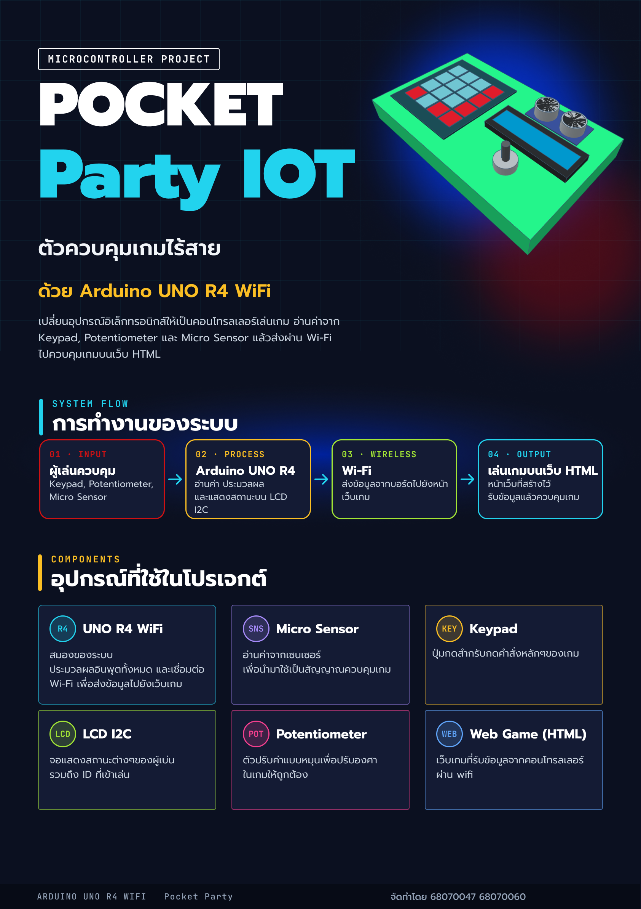

# Physical Computing Project 2026 - IT KMITL HI

## PocketParty IoT
> **Portable Dual-Controller Physical Party Game on Mobile Web**  
> ชุดเกมพกพาสำหรับ 2 ผู้เล่น ควบคุมด้วยเซนเซอร์และเชื่อมต่อหน้าจอสมาร์ตโฟนผ่าน Wi-Fi

---

### สมาชิกในกลุ่ม (Team Members)

| รหัสนักศึกษา | ชื่อ - นามสกุล |
| :---: | :--- |
| 68070047 | นายต่อตระกูล ดวงแก้ว|
| 68070060 | นายธนวัฒน์ แท่งทอง |

---

### บทคัดย่อและที่มาของโครงงาน (Abstract & Motivation)
ปัจจุบันวิดีโอเกมสำหรับงานสังสรรค์ (Party Game) ที่ให้ความรู้สึกสัมผัสทางกายภาพ (Tactile Interaction) มักมีราคาสูงและต้องการอุปกรณ์ขนาดใหญ่ เช่น โทรทัศน์หรือคอนโซลเฉพาะกลุ่ม ขณะที่เกมบนสมาร์ตโฟนทั่วไปขาดมิติของการมีปฏิสัมพันธ์ทางกายภาพ 

**PocketParty IoT** ถูกออกแบบขึ้นเพื่อแก้ปัญหานี้ โดยเป็นชุดคอนโทรลเลอร์ขนาดกะทัดรัด 2 ชุด (Player 1 และ Player 2) ที่ใช้เพียงสัญญาณ Hotspot จากโทรศัพท์มือถือเครื่องเดียว ผู้เล่นสามารถเปิดเบราว์เซอร์สมาร์ตโฟนบน GitHub Pages เพื่อใช้เป็นหน้าจอกลาง และร่วมประชันกันผ่านมินิเกมที่ดึงเซนเซอร์เชิงกายภาพมาวัดทักษะปฏิกิริยาตอบสนองอย่างแท้จริง

---

### ระบบมินิเกมและการทำงานของเซนเซอร์ (Game Mechanics)

1. **Red & Green Light:**
   * ใช้มือปัดผ่าน Ultrasonic Sensor หยุดตอนไฟเป็นสีแดง ใครถึงเส้นชัยก่อนชนะ
2. **Balloon Pump:**
   * วัดความแม่นยำ ดันมือขึ้นลงเหนือ Ultrasonic Sensor เพื่อปั้มลูกโป่ง
3. **Safe Cracker:**
   * แข่งกันปลดล็อคตู้เซฟ ด้วยการหมุน Potentiometer ให้หยุดที่เลขเป้าหมายให้เร็วที่สุด

---

### สถาปัตยกรรมระบบ (System Architecture)

```text
[ Controller 1: UNO R4 ] ──(Wi-Fi / MQTT)──────────────────────┐
  (Keypad, Ultrasonic, Potentiometer, LCD)                     ├──► [ Public MQTT Broker ] ──► [ Smartphone Web Browser ]
                                                               │       (WebSocket / WSS)          (GitHub Pages Host)
[ Controller 2: UNO R4 ] ──(Wi-Fi / MQTT)──────────────────────┘
  (Keypad, Ultrasonic, Potentiometer, LCD)
```
# YouTube
[คลิปเต็ม Pocket Party iot 68070047 68070060](https://youtu.be/PdKdqAweQaw)

# Poster


